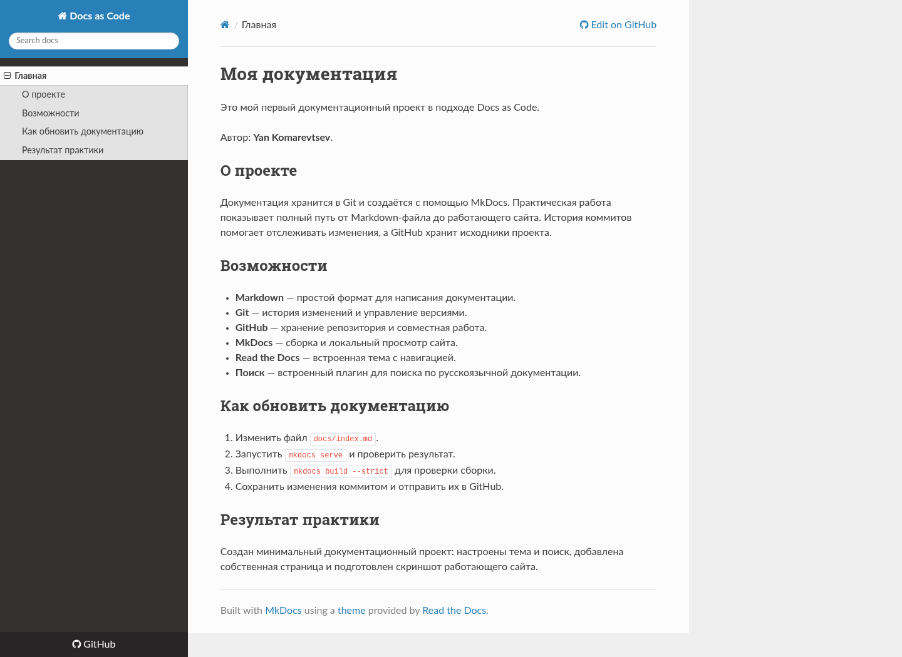

# Docs as Code

Практическая работа по настройке среды Docs as Code.

Автор: Yan Komarevtsev

## Запуск

Требуются Python 3.9+ и Git. Из корня репозитория:

```bash
python -m venv .venv
source .venv/bin/activate
python -m pip install -r requirements.txt
mkdocs serve
```

В Windows активируйте окружение командой `.venv\Scripts\activate`.
Откройте адрес, указанный MkDocs в терминале (по умолчанию порт 8000).

## Проверка сборки

```bash
mkdocs build --strict
```

Исходники документации находятся в `docs/`, настройки — в `mkdocs.yml`.
Используются встроенная тема `readthedocs` и плагин `search` с русским языком.
Каталоги `.venv/` и `site/` не добавляются в Git.

## Скриншот



## Практика 2: система определения спама

Добавлены описание проекта и комплект документации, три User Stories с критериями
приёмки, основной Use Case и две UML-диаграммы Mermaid.
Страницы доступны в разделе «Проект» навигации сайта.

Mermaid 10.9.3 включён локально в `docs/assets/vendor/`; лицензия MIT хранится
рядом. Скрипт `docs/assets/javascripts/diagrams.js` отображает блоки Mermaid
в браузере. Для просмотра диаграмм нужен JavaScript; доступ к CDN не требуется.
Источник библиотеки: https://cdn.jsdelivr.net/npm/mermaid@10.9.3/dist/mermaid.min.js

Скриншоты практики 2:

- [Страница проекта](screenshots/practice-2.png)
- [Диаграмма последовательности](screenshots/practice-2-sequence.png)
- [Диаграмма классов](screenshots/practice-2-classes.png)

Для сдачи: **Komarevtsev Yan — Система определения спама — https://github.com/Stolyan-2k/docs-as-code**.

## Практика 3: документирование API

- Спецификация: [`docs/api/openapi.yaml`](docs/api/openapi.yaml), OpenAPI 3.0.3.
- Описание и инструкция проверки: [`docs/api/index.md`](docs/api/index.md).
- После `mkdocs serve` откройте раздел «API», затем ссылку «Открыть Swagger UI».
- Описаны проверка сообщения, получение результата и сохранение исправленной категории.
- Backend не реализован; сервер условный, отправка запросов из Swagger UI отключена.
- Скриншот: [Swagger UI с раскрытой основной операцией](screenshots/practice-3-swagger.png).

Проверка контракта:

```bash
python -m pip install -r requirements-dev.txt
python -m openapi_spec_validator docs/api/openapi.yaml
mkdocs build --strict
```

Swagger UI 5.17.14 хранится в `docs/assets/vendor/swagger-ui/` вместе с лицензией
Apache-2.0. Источник: https://www.npmjs.com/package/swagger-ui-dist/v/5.17.14.
Для просмотра API внешний CDN не нужен.
