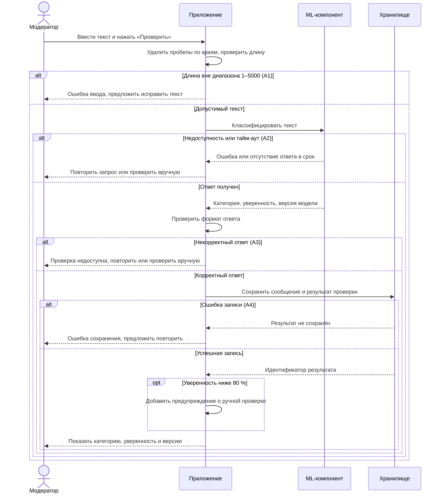
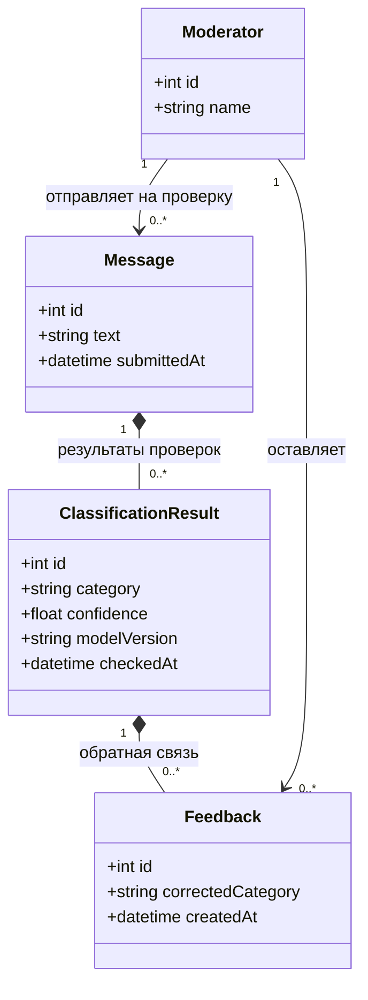

# Диаграммы

Диаграммы описывают [UC-01 и требования](requirements.md) системы определения спама.

## Диаграмма последовательности

Основной сценарий UC-01 и его альтернативные ветви:

Исправление категории (US-03) выполняется после успешной проверки и не включено
в эту диаграмму, чтобы сохранить соответствие выбранному Use Case.

## Диаграмма классов

Четыре сущности описывают данные проверки и обратную связь модератора.

- Одно сообщение может проверяться повторно; до успешной проверки результатов нет.
- Каждый результат связан с одним сообщением и содержит исходный ответ модели.
- Для результата допускается несколько записей обратной связи, каждая имеет одного автора.
- `category` и `correctedCategory` принимают `spam` или `ham`; `confidence` хранится от 0 до 1 и отображается в процентах.
- Обратная связь дополняет результат, не изменяя исходную категорию модели.
- Приложение, хранилище и ML-компонент — участники взаимодействия, а не сущности данных; в диаграмму классов они не включены.
